<picture>
  <source media="(prefers-color-scheme: dark)" srcset="assets/banner-dark.svg">
  
</picture>

Storygraphs is where I keep research projects while they are in progress. My published code, papers and activity are on my main profile, **[mwasim-research](https://github.com/mwasim-research)**.
